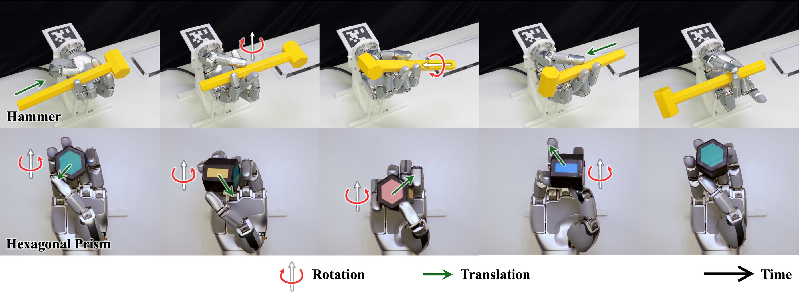

<h1 align="center">POISE: Learning In-Hand Object Reaching to General 6D Poses</h1>

<p align="center">
  Junxiao Lin<sup>2,1,3</sup>, Tianyue Wu<sup>2,3</sup>, Jie Yin<sup>2</sup>,
  Jia Pan<sup>3</sup>, Kaifeng Zhang<sup>2</sup>, Weiming Zhi<sup>1,*</sup>
</p>

<p align="center">
  <sup>1</sup>The University of Sydney &nbsp;&nbsp; <sup>2</sup>Sharpa &nbsp;&nbsp; <sup>3</sup>The University of Hong Kong
  <br>
  <sup>*</sup>Corresponding author
</p>

<h3 align="center">
  <a href="https://arxiv.org/abs/2609.13761">📄 Paper</a> |
  <a href="https://junxiaolin.github.io/poise-website/">🌐 Project Page</a>
</h3>

<p align="center">
  
</p>

## Overview

Learn to move a grasped object to palm-relative 6D target poses with coordinated
finger motions. Run the provided reference policies, train your own, or deploy
with RGB-D object-pose feedback.

## Abstract

**POISE** (**P**alm-relative **O**bject reaching **I**n **SE**(3)) is a sim-to-real
reinforcement learning framework for in-hand object reaching. It combines diverse
stable-grasp initialization, goal- and geometry-conditioned control, an adaptive
6D goal curriculum, and rewards for pose reaching and grasp preservation. This
repository provides training, reference checkpoints, grasp generation and
real-robot deployment interfaces for the **22-DoF Sharpa Wave right hand**.

## Repository structure

| Directory | Contents |
|---|---|
| [`source/poise/core/`](source/poise/core/) | Observations, actions, transforms and policy interfaces |
| [`source/poise/sim/`](source/poise/sim/), [`training/`](source/poise/training/) | Isaac Lab environments, PPO, distributed training and checkpoint recovery |
| [`source/poise/grasp/`](source/poise/grasp/) | LyGra adapters, grasp generation and filtering support |
| [`source/poise/deploy/`](source/poise/deploy/) | FoundationPose, RGB-D calibration and hand control |
| [`configs/`](configs/), [`manifests/`](manifests/) | Versioned setups, rollout settings, asset dependencies and hashes |
| [`environments/`](environments/), [`dependencies/`](dependencies/) | Separate environments and pinned optional dependencies |
| [`scripts/`](scripts/), [`docs/`](docs/), [`tests/`](tests/) | Entry points, guides, baseline records and tests |

Training, grasp generation and deployment use separate environments. Poise's
adapters ship here; optional upstream sources are fetched only when needed.
Assets and checkpoints are separate packages, with shared files reused across setups.

## Quick start

Use a source checkout in a prepared **Isaac Sim 5.1 / Isaac Lab 0.48** environment.
Training and simulation do not require LyGra or FoundationPose.

```bash
# Run from the repository root in the Isaac Lab Python environment.
python -m pip install -r environments/train/requirements.txt
python -m pip install --no-deps -e .
poise check-env train --native

# Download the required release packages; shared files are reused and verified.
poise fetch-assets --setup hexprism40_palmup_v1 --with-reference
poise check-assets --setup hexprism40_palmup_v1 --with-reference --deep

# Visualize the reference policy; add --headless for no GUI.
poise rollout --setup hexprism40_palmup_v1 --output outputs/rollout/reference

# Check training with two PPO updates.
poise train --setup hexprism40_palmup_v1 --profile smoke --output outputs/train/smoke
```

Output directories must be new. Use `custom` or `reference` for longer training;
see the [reproduction guide](docs/reproduction.md) for hardware and launch settings.
Assets and checkpoints are available in [Releases](https://github.com/junxiaolin/Poise/releases/tag/v0.1.0-rc1).

## Reference setups

| Setup | Objects / wrist | Checkpoint |
|---|---|---|
| `hexprism40_palmup_v1` | Hex40 / palm up | `model_31200.pt` |
| `manualconvex9_palmup_v1` | Nine objects, one shared policy / palm up | `model_23300.pt` |
| `hexprism40_omniwrist_fullpose_v1` | Hex40 / random wrist | `model_35800.pt` |
| `hexhammer_palmup_fullpose_192k_v1` | HexHammer / palm up | `model_89800.pt` |

All four use Sharpa Wave, strict FullPose success and **no tactile input**.
Provided grasp caches and checkpoints let you run these policies without
regenerating grasps or retraining. Random wrist orientation is sampled at reset
and remains fixed within each episode. See [baseline records](docs/baselines/README.md).

## Training tips

- **Relax success thresholds** to help the curriculum progress and training converge
  faster—for example, 15° / 15 mm instead of 10° / 10 mm. Report the thresholds
  when comparing results.
- **Add tactile observations** to help training converge faster: fingertip contact
  forces and contact-position history in the actor and critic. Train a compatible
  tactile policy; the reference checkpoints above use the non-tactile interface.

These are empirical tuning tips; gains depend on the object and training setup.
Keep the frozen reference setups unchanged and create a custom recipe for experiments.

## Beyond the provided setups

- **New objects:** generate grasps with `lygra-poise`, apply Isaac physics filtering,
  then train a policy. Full, fast and smoke profiles are available. See [new objects](docs/new_objects.md).
- **New hands:** require code adaptation and retraining; only Sharpa Wave is currently supported.
- **Real hardware:** requires `foundationpose-poise`, camera calibration and the
  hand SDK for RGB-D pose tracking and policy control. See [deployment](docs/deployment.md).

## Citation

If you use POISE in your research, please cite:

```bibtex
@article{lin2026poise,
  title   = {Learning In-Hand Object Reaching to General 6D Poses},
  author  = {Lin, Junxiao and Wu, Tianyue and Yin, Jie and Pan, Jia and Zhang, Kaifeng and Zhi, Weiming},
  journal = {arXiv preprint arXiv:2609.13761},
  year    = {2026},
  url     = {https://arxiv.org/abs/2609.13761}
}
```

## Acknowledgments

POISE builds on Isaac Lab and RSL-RL, with [LyGra](docs/lightning_grasp.md) for grasp
generation, [FoundationPose](environments/foundationpose-poise/README.md) for pose
tracking, and [Sharpa Wave assets](docs/hand_assets.md). We thank their authors and
contributors. See [NOTICE](NOTICE) for attribution and third-party terms.

## License

Poise-owned code: [MIT](LICENSE). Authored data and weights: **CC BY 4.0**.
Third-party terms, including the non-commercial LyGra-derived components, are
listed in [NOTICE](NOTICE).
