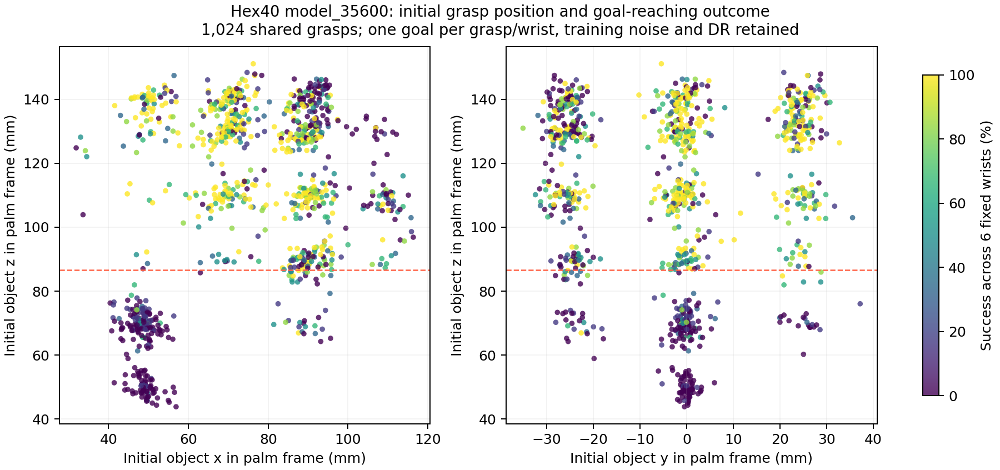

# 初始 grasp 空间分布与成功率的关系

对同一批 1,024 个初始抓取、7,168 次已完成试验做事后分析，不重新训练策略。
这些样本来自 431 个母手势；完整缓存为 6,842 行、486 个母手势。

## 初始位置关联很强

以下 z 是**掌根坐标系**中的初始物体中心坐标，不是世界高度。每行 256 个初始抓取；
六固定腕姿列汇总 1,536 次试验，随机腕姿列为 256 次。

| 初始 z 范围 (mm) | 六固定腕姿成功率 | 随机腕姿成功率 | 随机腕姿成功前掉落率 | 随机腕姿失败且超时率 |
| --- | ---: | ---: | ---: | ---: |
| 43.9–86.7 | 12.7% | 10.5% | 18.8% | 70.7% |
| 86.7–111.1 | 61.7% | 63.7% | 20.7% | 15.6% |
| 111.1–133.2 | 63.1% | 59.8% | 23.8% | 16.4% |
| 133.2–151.1 | 55.8% | 52.0% | 35.2% | 12.9% |

最差 z 区间在掌心朝上时也只有 8.6% 成功，在朝 −X 时为 32.4%。这说明腕姿与抓取位置共同影响表现。
低 z 组随机腕姿有 249/256 个目标通过最终几何可行性检查；7 个不通过的目标不足以解释总体低成功率。
该组目标平均旋转 95.4°，其余组为 83.5–88.9°；平均平移都约 15.1–15.6 mm。

## 控制目标难度后的预测关联

使用固定 L2 正则 logistic 模型，5 折按母手势 source_seed_index 分组；同一母手势的所有变体和腕姿试验放在同一折，避免变体泄漏。
以下是 out-of-fold AUC，衡量区分成功/失败的能力，不是策略成功率。

| 特征 | AUC | Log loss |
| --- | ---: | ---: |
| 腕姿 + 目标旋转/平移 + 可行性 | 0.621 | 0.668 |
| 再加初始位置与二次项 | 0.816 | 0.523 |
| 仅再加初始物体朝向 | 0.626 | 0.669 |
| 仅再加空间稀疏度 | 0.627 | 0.667 |
| 再加完整初始位姿与稀疏度 | 0.816 | 0.523 |
| 再加完整位姿、稀疏度与手指关节角 | 0.818 | 0.521 |

初始位置具有明显额外预测力；在这个模型和数据范围内，朝向、密度单独增加的预测力很小。这不能证明朝向对所有情形都不重要。

## 不是简单的“越密越好”

将完整缓存中的位置与 SO(3) 朝向合成距离：位置尺度 20 mm、角度尺度 45°，计算最近 20 个邻居平均距离（排除自身，包含扰动变体）。
该密度度量依赖尺度选择，仅用于探索。

| 密度组 | 六固定腕姿成功率 | 随机腕姿成功率 |
| --- | ---: | ---: |
| 最密集 | 35.6% | 37.1% |
| 较密集 | 53.6% | 52.7% |
| 较稀疏 | 56.8% | 52.7% |
| 最稀疏 | 47.3% | 43.4% |

空间覆盖广不等于每个抓取状态都容易完成重定向。大量扰动变体也可能集中在不利操作区域。现有证据不支持把问题直接归因于覆盖不足。

## 结论边界与下一步

这是关联分析，不是改变抓取分布后的因果实验。每个 grasp/腕姿目前只测试一个目标，仍无法完整分离抓取质量、具体目标、接触结构和随机动力学的影响。
下一步优先对低 z 与中 z 区域的抓取，分别重复多个目标和随机种子，并先测“保持原位”与“小角度/小平移”任务；
用初始保持成功率、首次达标时间和超时率区分静态稳定性与后续可操作性，再决定是否调整母手势筛选或分区采样。不要直接删除低成功区域来提高报表数字。

脚本：`scripts/evaluation/wrist_orientation/analyze_grasps.py` 与 `analyze_grasp_controls.py`。完整统计见本目录两个 JSON。
